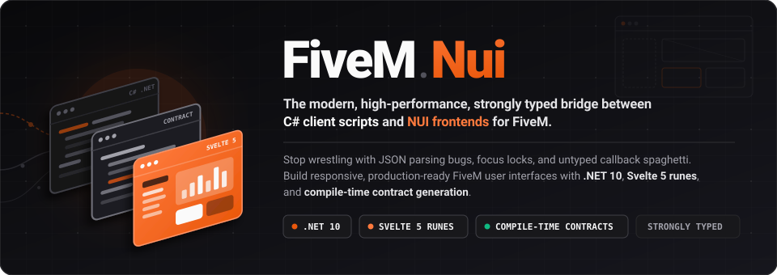
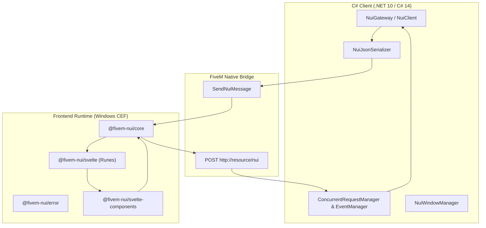

[](LICENSE)
[](https://dotnet.microsoft.com/)
[](https://learn.microsoft.com/dotnet/csharp/)
[](packages/fivem-nui/core)
[](packages/svelte/bridge)
[](packages/fivem-nui/core)
[](docs/README.md)

---

## Documentation & Guides

Complete technical guides and dedicated role manuals are available in [`docs/`](docs/README.md):

### Role Guides
- [**Server Owners & Administrators**](docs/server-owners/README.md) — FiveM Enhanced (CoreCLR), `server.cfg` setup, 0.00ms resmon optimization, no cursor freeze, and anti-cheat/DoS protection.
- [**Developers & UI Creators**](docs/developers/README.md) — Step-by-step development manual: C# 14 + Svelte 5 Runes, Roslyn automated contracts, 20+ ready UI components, and 10x faster browser workflow in Chrome without starting GTA V.

### Technical References
| Guide | Description |
|---|---|
| [**System Architecture & Scaffolding**](docs/developers/README.md) | Component architecture, event flow, and resource structure. |
| [**Contracts & Type Generation**](docs/developers/contracts.md) | Roslyn CLI & MSBuild emitting TypeScript DTOs from C# records. |
| [**C# 14 Backend & CoreCLR**](docs/developers/backend-csharp.md) | `NuiGateway`, `IScript`, `RegisterCallback`, and serialized mutations. |
| [**Svelte 5 Runes & Bridge**](docs/developers/frontend-svelte.md) | `nui`, `useNuiState`, `useNuiQuery`, and automatic `useNuiWindow`. |
| [**UI Component Suite**](docs/developers/components/README.md) | 20+ accessible FiveM CEF components (`NuiButton`, `NuiModal`, `NuiCard`). |
| [**Browser Mocking & Tooling**](docs/developers/browser-mock-and-tools.md) | `setupNuiMock` in Chrome with Vite HMR, and `dotnet publish`. |
| [**Testing without FiveM**](docs/developers/testing.md) | In-memory fake bridge, mocking C# responses, and failure simulation. |
| [**C# API Reference**](docs/api/csharp.md) | Technical reference for `NuiGateway`, `NuiClient`, and `NuiOptions`. |
| [**TypeScript API Reference**](docs/api/typescript.md) | Technical reference for `@fivem-nui/core`, `@fivem-nui/svelte`, `@fivem-nui/error`. |
| [**Wire Protocol & Envelopes**](docs/api/protocol.md) | Envelope JSON schema, UUIDv7 correlation, and network error codes. |

---

## Why FiveM.Nui?

Traditional FiveM NUI development is plagued by untyped strings, silent network failures, and tedious game restarts:

| The Traditional FiveM Pain | The FiveM.Nui Solution |
|---|---|
| **Untyped String Callbacks** (`RegisterNUICallback("use", ...)` with JSON typos) | **Compile-Time Type Safety**: TypeScript `NuiEventMap` infers request and response payloads automatically. |
| **Input Focus Traps** (`SetNuiFocus` bugs permanently locking cursor or game movement) | **Managed Window & Focus Stack**: `ShowAsync` and `HideAsync` handle keyboard ownership and state transitions cleanly. |
| **Silent Network Hangs** (an unhandled exception in C# leaves frontend `fetch()` pending forever) | **Structured Error Boundaries**: Every request returns a typed `NuiResult<T>` with timeout deadlines and cancellation tokens. |
| **45-Second FiveM Reload Loops** (restarting the game or server just to tweak a CSS button) | **Instant Local Browser Mocking**: Use `setupNuiMock` in Chrome with Vite HMR — develop 10x faster without launching GTA V! |
| **Contract Drift & Double Typing** (manually keeping C# classes and TS interfaces in sync) | **Automated Roslyn Generator**: Compile your C# assembly and get zero-drift TypeScript interfaces and TSDoc comments. |
| **Reinventing Game UI Components** (writing accessible menus, select boxes, and dialogs from scratch) | **20+ Production UI Components**: Ready-to-use Svelte 5 components hardened specifically for FiveM's CEF runtime. |

---

## Key Features



### 1. Strongly Typed Communication
Say goodbye to `dynamic` or hand-cast `Dictionary<string, object>`. C# records implement `INuiRequest<TResponse>`, and TypeScript infers the exact return type:

```csharp
// Shared C# Contract
[NuiEvent("garage:spawn")]
public sealed record SpawnVehicleRequest(string VehicleModel, string Plate) : INuiRequest<SpawnVehicleResponse>;
public sealed record SpawnVehicleResponse(bool Success, string NetId);
```

```ts
// Frontend automatically knows parameter and response types!
const result = await nui.request('garage:spawn', { 
  vehicleModel: 'banshee',
  plate: 'OUTLAW'
});
console.log(result.netId);
```

### 2. Zero-Lag Svelte 5 Runes
Leverage modern Svelte 5 reactivity (`$state`, `$derived`, `$effect`) for instant HUD updates with zero runtime overhead:

```svelte
<script lang="ts">
  import { useNuiState, useNuiQuery } from '@fivem-nui/svelte';
  import { NuiButton } from '@fivem-nui/svelte-components';

  // Automatically reactive to C# Publish events
  const speed = useNuiState<number>('vehicle:speed', 0);
  const ejectQuery = useNuiQuery('vehicle:eject');
</script>

<div class="hud">
  <span>{speed.value} KM/H</span>
  <NuiButton loading={ejectQuery.loading} onclick={() => ejectQuery.execute()}>
    Eject
  </NuiButton>
</div>
```

### 3. 10x Faster Development with Browser Mocking
Don't wait 45 seconds for FiveM to restart. Test your entire NUI interface directly in your browser with realistic network delays:

```ts
import { setupNuiMock, isBrowser } from '@fivem-nui/svelte';

if (isBrowser()) {
  setupNuiMock({
    requests: {
      'player:getData': async () => ({
        name: 'Officer John',
        cash: 45000,
      }),
    },
    latencyMs: 150,
  });
}
```

### 4. Bulletproof Window & Focus Management
Never get your keyboard stuck in NUI again. `NuiGateway` provides reliable window lifecycle hooks:

```csharp
public class InventoryScript : BaseScript
{
    private readonly NuiGateway _nui = new("inventory");

    public InventoryScript()
    {
        _nui.Bootstrap(
            onReady: () =>
            {
                _nui.Publish("inventory:sync", GetItems());
                return Task.CompletedTask;
            }
        );
    }

    [Command("inventory")]
    public async void Toggle() => await _nui.ShowAsync("inventory");
}
```

---

## Packages in this Repository

| Package | Version | Description |
|---|---|---|
| [**`FiveM.Nui`**](src/) | `1.1.0` | Core C# client library targeting .NET 10. |
| [**`tools/FiveM.Nui.Contracts`**](tools/FiveM.Nui.Contracts/) | `1.1.0` | Roslyn CLI tool generating TypeScript DTOs and event maps. |
| [**`@fivem-nui/core`**](packages/fivem-nui/core/) | `1.1.0` | Zero-dependency TypeScript bridge and testing kit. |
| [**`@fivem-nui/error`**](packages/fivem-nui/error/) | `1.0.0` | Global error handling, stack trace parsing, and exponential retry. |
| [**`@fivem-nui/svelte`**](packages/svelte/bridge/) | `1.1.0` | Svelte 5 runes (`useNuiState`, `useNuiQuery`) and browser mock. |
| [**`@fivem-nui/svelte-components`**](packages/svelte/components/) | `1.1.0` | Accessible 20+ component suite designed for FiveM CEF. |

---

## Quick Installation

### 1. Add C# Library (NuGet)
Install the `FiveM.Nui` package into your client script project:
```bash
dotnet add package FiveM.Nui
```
Or add the package reference directly to your `.csproj`:
```xml
<ItemGroup>
  <PackageReference Include="FiveM.Nui" Version="1.1.0" />
</ItemGroup>
```

### 2. Install Frontend Packages (npm)
Install the official npm packages into your NUI web project (`web/`):
```bash
npm install @fivem-nui/svelte @fivem-nui/svelte-components @fivem-nui/core @fivem-nui/error
```
Or declare them in your `package.json`:
```json
{
  "dependencies": {
    "@fivem-nui/core": "^1.0.0",
    "@fivem-nui/error": "^1.0.0",
    "@fivem-nui/svelte": "^1.0.0",
    "@fivem-nui/svelte-components": "^1.0.0"
  }
}
```

### 3. Contracts Generator CLI
Install the Roslyn-based CLI tool to generate TypeScript contracts automatically:
```bash
dotnet tool install -g FiveM.Nui.Contracts
```

---

## Taskfile Developer Commands

```bash
# Build all C# and TypeScript packages in order
task build

# Run type-checks in parallel
task check

# Execute all test suites (xUnit + Vitest)
task test

# Clean all build outputs
task clean
```

---

## Contributing

Contributions, issues, and feature requests are welcome!  
Feel free to check out the [Issues tab](https://github.com/rian-be/FiveM.Nui/issues) and our [Architecture Guide](docs/developers/README.md).

---

## License

FiveM.Nui is licensed under the [MIT License](LICENSE).  
Copyright © 2026 Rian.be.
