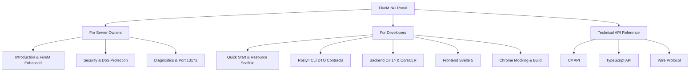

# FiveM.Nui Documentation Portal

> **A modern, secure, and strictly typed bridge between client C# scripts (.NET 10) and NUI web panels (Svelte 5) engineered specifically for FiveM Enhanced.**

---

## Choose Your Learning Path

The documentation is organized into role-based sections so you can immediately find what you need:

---

## 1. For Server Owners & Administrators
Everything you need to know about deployment, server stability, and security:

| Guide | Description |
|---|---|
| [**Introduction & Installation**](server-owners/README.md) | What is FiveM.Nui, why FiveM Enhanced (CoreCLR) beats legacy Mono, `server.cfg` setup, and `0.00 ms` resmon. |
| [**Security & FAQ**](server-owners/security-and-faq.md) | CEF threat model, anti-cheat protection, DoS limits (`MaxPayloadSize`), and Server Authority principles. |
| [**Troubleshooting**](server-owners/troubleshooting.md) | Remote CEF debugging via Google Chrome (`http://localhost:13172`) and production launch checklist. |

---

## 2. For Developers & UI Creators
A practical, step-by-step developer guide for building high-performance resources:

| Guide | Description |
|---|---|
| [**Quick Start & Resource Scaffold**](developers/README.md) | Architecture overview, ready-to-use `fxmanifest.lua`, `.csproj`, `package.json`, and data flow. |
| [**Automated DTO Contracts**](developers/contracts.md) | Stop writing duplicate types: `[NuiContract]`, `[NuiEvent]` attributes and Roslyn CLI TypeScript generator. |
| [**Backend C# 14 & CoreCLR**](developers/backend-csharp.md) | `NuiGateway` callbacks, `Publish`, `SendAsync`, `RequestAsync`, and window lifecycle. |
| [**Frontend Svelte 5**](developers/frontend-svelte.md) | Reactive UI with Svelte 5 Runes: `nui`, `useNuiState`, `useNuiQuery`, and automatic `useNuiWindow`. |
| [**UI Components & Design System**](developers/components/README.md) | Over 20 accessible, themed components from `@fivem-nui/svelte-components` plus keyboard & UI composables. |
| [**Browser Mocking & Build**](developers/browser-mock-and-tools.md) | Rapid UI iteration in Google Chrome with `setupNuiMock` and Vite HMR without starting GTA V. |
| [**Testing without FiveM**](developers/testing.md) | Isolated frontend unit tests with `@fivem-nui/core/testing`, in-memory fake transport, and mocks. |

---

## 3. Technical API Reference
Exhaustive specifications of classes, methods, and protocols:

| Specification | Description |
|---|---|
| [**C# API Reference**](api/csharp.md) | Full specification of `NuiGateway`, `NuiClient`, `NuiOptions`, and `NuiResult<T>`. |
| [**TypeScript API Reference**](api/typescript.md) | API reference for `@fivem-nui/core`, `@fivem-nui/svelte`, and `@fivem-nui/error`. |
| [**Network Wire Protocol**](api/protocol.md) | `NuiMessage` JSON envelope format, UUIDv7 correlation IDs, and error codes. |
